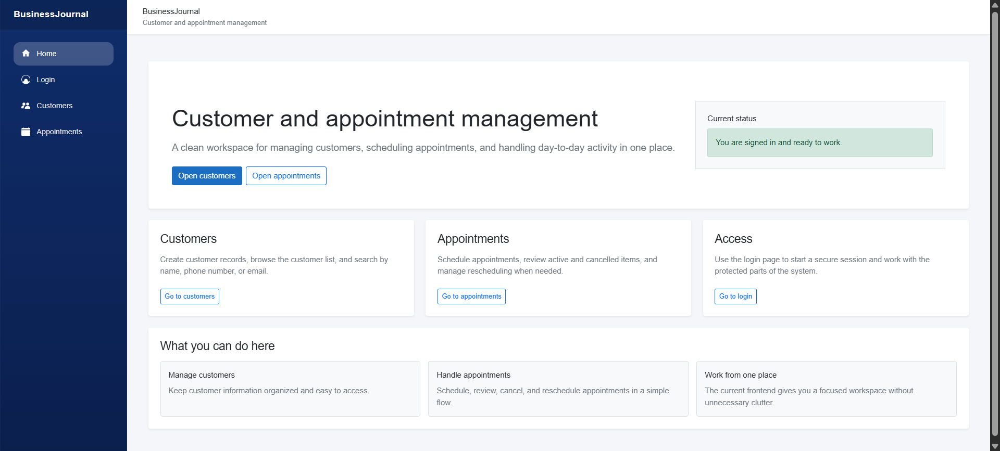
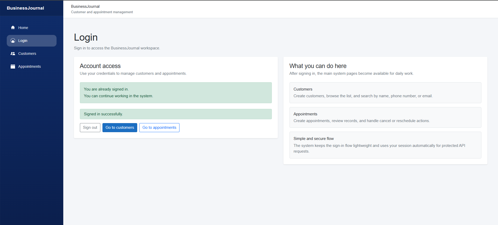
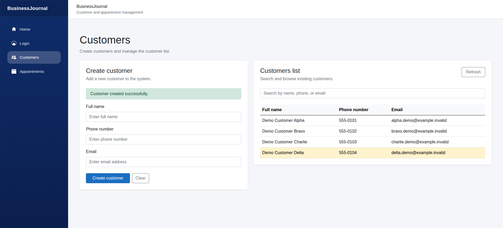
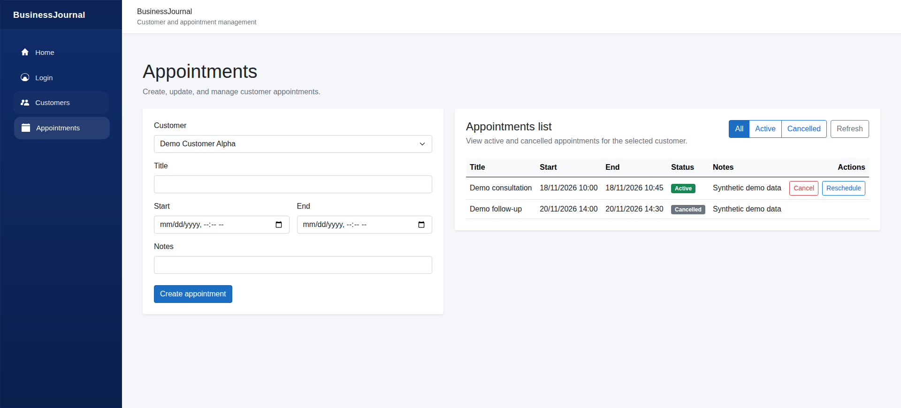

# BusinessJournal

> .NET 8 | Clean Architecture | SQL Server (ADO.NET) | JWT | 185 automated tests

BusinessJournal is a compact customer and appointment scheduling system with a strong backend focus: an ASP.NET Core Web API over SQL Server, and a small Blazor Server frontend that consumes it.

It is a portfolio project and is not deployed.

---

## What this system does

- Customers: register a customer (full name, phone number, optional email), get one by id, and list all customers. The Blazor page filters the loaded list by name, phone number or email; the API has no search endpoint. Customers cannot be edited or deleted.
- Appointments: schedule, get by id, list a customer's appointments, cancel, and reschedule. Appointments are cancelled, never deleted.
- Overlapping active appointments are rejected. Time ranges are half-open, `[start, end)`, so back-to-back appointments are allowed. Cancelled appointments free their slot and cannot be rescheduled.
- All customer and appointment endpoints require a JWT bearer token.

---

## Tech Stack

Backend:
- .NET 8 (`net8.0`), ASP.NET Core Web API with controllers
- SQL Server through Microsoft.Data.SqlClient (plain ADO.NET, no ORM)
- JWT bearer authentication
- ASP.NET Core built-in rate limiting
- Swagger UI in the Development environment

Frontend:
- Blazor Server (interactive server rendering)
- Typed HttpClient API clients

Testing:
- xUnit
- Microsoft.AspNetCore.Mvc.Testing for in-process API hosts

---

## Architecture

The solution is split into clear layers:

- BusinessJournal.Domain  
  Entities and value objects (Customer, Appointment, AppUser, TimeRange) and their invariants

- BusinessJournal.Application  
  Services (CustomerService, AppointmentService, AuthService), repository interfaces, application errors

- BusinessJournal.Infrastructure  
  SQL and in-memory repositories, connection factory, calendar lock, JWT generation, password hashing

- BusinessJournal.Api  
  Controllers, authentication, rate limiting, global exception handling

- BusinessJournal.Web  
  Blazor Server frontend

- BusinessJournal.Console  
  Small console demo of the services with in-memory repositories

- BusinessJournal.Tests  
  Tests for all layers

---

## Scheduling Integrity

The system models one provider with one shared calendar: no two active appointments may overlap, whichever customer they belong to.

- Every calendar change (schedule, reschedule, cancel) runs on one SQL connection in one transaction. It first takes an exclusive, transaction-owned SQL Server application lock (`sp_getapplock`) on a single calendar resource, then checks its rules, writes, and commits. The lock is released only at commit or rollback, so concurrent changes run one at a time and each one sees the committed result of the previous one.
- Reschedule changes only the start and end columns, and only while the appointment is still active. Cancel changes only the cancellation flag. A delayed reschedule therefore cannot undo a cancellation.
- The lock wait is limited to 5 seconds. A timeout returns `503` (nothing was changed; the request can be retried). A slot or state conflict returns `409`. Any other lock failure is rolled back and returns a generic `500`.
- Concurrency tests check the guarantees against SQL Server: simultaneous requests for one free slot produce exactly one `201` and only `409` for the rest, concurrent cancel and reschedule requests never lose a cancellation, and deterministic tests hold the lock from a second connection to prove that a waiting change sees the conflict committed before it.

---

## SQL and Persistence

- SQL Server with explicit, parameterized SQL
- Schema scripts under `database/`
- `001_create_customers.sql` creates `dbo.Customers` if it does not exist
- `002_create_appointments.sql` creates `dbo.Appointments` if it does not exist. If the table already exists, it checks the exact column set (names, types, nullability), the primary key, the foreign key to `dbo.Customers`, the CHECK and DEFAULT constraints, and the key columns of its two indexes, and stops with error `50001` without changing anything when one of them differs. This is a targeted check, not a full schema comparison: for example, additional indexes, triggers and index options are not compared. Existing rows are never dropped. Only a missing index with the expected name is added.
- Repository pattern (pragmatic), no ORM (intentional)

---

## Authentication and Security

- JWT bearer tokens with validated issuer, audience, lifetime and signing key.
- The signing key is not stored in the repository. The API refuses to start without a private key of at least 32 bytes and rejects known example keys.
- Passwords are hashed with the ASP.NET Core Identity password hasher.
- Users are kept in memory. There is no registration and no user database. In the Development environment the API creates one administrator account at startup; its email and password are set in `SeedDevelopmentAdmin` in `src/BusinessJournal.Api/Program.cs`. Outside Development no account exists. Accounts are lost when the API stops.
- Tokens carry a role claim, but endpoints only require an authenticated user. There is no role-based authorization.
- Application errors are returned as ProblemDetails: `400`, `401` (failed login), `404`, `409` and `503`. Unexpected errors return a generic `500` with a trace id; details stay in the server log.

---

## Rate Limiting

- Only the login endpoint (`POST /api/auth/login`) is rate limited: 5 attempts per client IP in a sliding 5-minute window, then `429` with a `Retry-After` header.
- `X-Forwarded-For` is trusted only from proxies listed under `ReverseProxy:KnownProxies` or `ReverseProxy:KnownNetworks`.
- Other endpoints are not rate limited.

---

## Testing

185 xUnit tests, as discovered in the last full run:

| Category | Tests | Needs SQL Server |
| --- | ---: | :---: |
| Unit tests: Domain, Application, Infrastructure without SQL, Web clients, test guard | 111 | No |
| API host tests with in-memory fakes (error responses, startup validation) | 8 | No |
| SQL Server integration tests (repositories, calendar lock, schema scripts) | 34 | Yes |
| API integration tests (in-process HTTP host with SQL Server, including concurrency) | 32 | Yes |

119 tests run without SQL Server; 66 need it. 13 of the SQL-dependent tests are concurrency tests.

The SQL-dependent tests delete all customers and appointments, and the schema tests create and drop their own scratch databases. They run only against a dedicated disposable database: a guard (`tests/BusinessJournal.Tests/TestSupport/DisposableTestDatabase.cs`) refuses to run unless

- the connection string comes from the `BUSINESSJOURNAL_SQL_CONNECTION` environment variable (never from user-secrets or appsettings),
- the server is a loopback address,
- the database name ends with `_DisposableIT`, and
- the database contains `dbo.__DisposableTestDatabaseMarker` with the token from `BUSINESSJOURNAL_TEST_DB_TOKEN`.

Never point these tests at a database whose data you need.

---

## Running Locally

Prerequisites:
- .NET 8 SDK or later
- A SQL Server instance where you can create databases, and `sqlcmd`

Commands run from the repository root. `sqlcmd` reads the password from `SQLCMDPASSWORD` or asks for it. `-C` trusts the server certificate; leave it out if your server has a trusted certificate.

1. Create the database and schema:

```bash
sqlcmd -S localhost -U sa -C -b -Q "CREATE DATABASE BusinessJournal"
```

```bash
sqlcmd -S localhost -U sa -C -b -d BusinessJournal -i database/001_create_customers.sql -i database/002_create_appointments.sql
```

2. Configure the API. These values stay on your machine (user-secrets), outside the repository. Replace the placeholders with your own values:

```bash
dotnet user-secrets set "SqlServer:ConnectionString" "Server=localhost;Database=BusinessJournal;User Id=<user>;Password=<password>;TrustServerCertificate=True" --project src/BusinessJournal.Api
```

```bash
dotnet user-secrets set "Jwt:SigningKey" "$(openssl rand -base64 48)" --project src/BusinessJournal.Api
```

The environment variables `SqlServer__ConnectionString` and `Jwt__SigningKey` work as well.

3. Start the API (Development environment, http://localhost:5159, Swagger at `/swagger`):

```bash
dotnet run --project src/BusinessJournal.Api --launch-profile http
```

4. In a second terminal, start the Web app (http://localhost:5284). Development settings files are not committed, so pass the API address in the `Api__BaseUrl` environment variable:

```bash
Api__BaseUrl=http://localhost:5159 dotnet run --project src/BusinessJournal.Web --launch-profile http
```

5. Sign in with the development account from `SeedDevelopmentAdmin`.

### Tests without SQL Server

```bash
dotnet test tests/BusinessJournal.Tests/BusinessJournal.Tests.csproj --filter "FullyQualifiedName!~BusinessJournal.Tests.Api.&FullyQualifiedName!~SqlAppointmentRepositoryTests&FullyQualifiedName!~SqlCustomerRepositoryTests&FullyQualifiedName!~SqlDisposableDatabaseGuardTests&FullyQualifiedName!~SqlCalendarConcurrencyTests&FullyQualifiedName!~SchemaScriptTests"
```

Without the test environment variables, the SQL-dependent tests stop with "Refusing to use this database for tests" instead of connecting anywhere.

### Full suite with a disposable database

This example uses a throwaway local Docker container. Use a password made of letters and digits only, because it is placed inside a connection string. The login needs permission to create databases (schema tests) and `VIEW SERVER STATE` (lock tests); `sa` has both.

```bash
export SA_PASSWORD='<letters-and-digits-password>'
```

```bash
docker run -d --name bj-test-sql -e ACCEPT_EULA=Y -e MSSQL_SA_PASSWORD="$SA_PASSWORD" -p 127.0.0.1:14333:1433 mcr.microsoft.com/mssql/server:2022-latest
```

When the server accepts connections, create the disposable database, its schema and its marker, then run the tests:

```bash
export SQLCMDPASSWORD="$SA_PASSWORD"
export BUSINESSJOURNAL_TEST_DB_TOKEN="$(openssl rand -hex 24)"
sqlcmd -S 127.0.0.1,14333 -U sa -C -b -Q "CREATE DATABASE BusinessJournal_DisposableIT"
sqlcmd -S 127.0.0.1,14333 -U sa -C -b -d BusinessJournal_DisposableIT -i database/001_create_customers.sql -i database/002_create_appointments.sql
sqlcmd -S 127.0.0.1,14333 -U sa -C -b -d BusinessJournal_DisposableIT -Q "CREATE TABLE dbo.__DisposableTestDatabaseMarker (Token NVARCHAR(128) NOT NULL); INSERT INTO dbo.__DisposableTestDatabaseMarker (Token) VALUES (N'$BUSINESSJOURNAL_TEST_DB_TOKEN');"
export BUSINESSJOURNAL_SQL_CONNECTION="Server=127.0.0.1,14333;Database=BusinessJournal_DisposableIT;User Id=sa;Password=$SA_PASSWORD;Encrypt=True;TrustServerCertificate=True"
dotnet test tests/BusinessJournal.Tests/BusinessJournal.Tests.csproj
```

Remove the container afterwards:

```bash
docker rm -f bj-test-sql
```

---

## Screenshots

All data shown is synthetic demo data.

Home:


Login:


Customers:


Appointments:


---

## Known Limitations

- One provider and one global calendar. Overlaps are checked across all appointments, not per staff member or resource.
- A single SQL application lock serializes every calendar change. This is simple and correct for one small calendar, but it limits throughput under heavy concurrent writes. Throughput has not been measured.
- Data access is synchronous ADO.NET, so each request holds a thread while it waits for SQL Server.
- No time-zone policy. Appointment times are stored as `datetime2` exactly as received, without an offset or UTC conversion. The Blazor UI sends the date and time as entered, without a time zone.
- Blazor sign-in is kept in memory for one circuit (one browser tab). Refreshing the page signs the user out.
- Users exist only in memory, and the only account is the development administrator. There is no user management.
- No role-based authorization and no multi-tenant isolation: every signed-in user can see and change all customers and appointments.
- Only the login endpoint is rate limited.
- The Web UI shows a generic error message when the API returns `503`.

---

## Design Goals

- Clean and readable code
- SOLID where it matters
- Clear separation of concerns
- No over-engineering
- End-to-end working system

---

## Author

Built as part of my journey toward a backend developer role (C# / .NET).